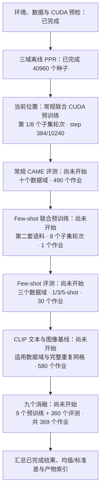

# 全 CAME 主任务与安全暂停续跑

## 全流程定位图（状态快照：2026-10-11 19:10 北京时间）

以下来自运行中 ledger 与 JSONL，不会自动刷新。三域离线 PPR 已全部完成；当前为第一套联合预训练，第 1/8 个子集轮次，累计 384/10,240 次 optimizer 更新（3.75% 的当前预训练更新预算）。第一个子集轮次预算为 1,280 个 batch，已执行 384 个（30%）。完整作业尚未结束，所以 completed_jobs=0/1471；不能把这个计数当作前期数据/环境准备没有完成。

第一套预训练语料为 Products + Goodreads-LP + Cloth；第二套为 Products + Goodreads-NC + Cloth。两套均保留完整作者主模型、固定种子池、离线 PPR 和声明的 8 个子集轮次；其种子池大小属于重建/容量适配，不能把它称为已确认与作者原始预算完全一致。

常规评测按当前入口顺序执行：Ele-fashion → Wiki-CS → Arxiv → Goodreads-NC → Products → Sports → Cloth → Goodreads-LP → FB15K237 → WN18RR。前五项是节点分类，中间三项是 LP，最后两项是 KG 关系分类。Wiki-CS 节点分类排为 20 split × 20 初始化；其他域十个下游 seeds。当前主预训练完成后，首先会产生 Ele-fashion 的下游结果，而不是等所有 1471 个作业结束后才有单个结果。

当前第 1 个轮次的种子覆盖：Products 4096/16384、Goodreads-LP 4096/16384、Cloth 4096/8192。这是种子覆盖，不是完整图中参与消息传递的所有节点覆盖。第一套主模型的完整预训练作业完成后，才解锁它的下游评测。现在没有正式节点 accuracy 或 LP MRR 可汇报。

各阶段都有日志、JSONL/CSV、TensorBoard、配置/来源指纹和检查点；预训练生成 loss/资源/表征/专家图，分类生成验证选模曲线与预测，LP 生成验证曲线与 ranks，few-shot 保存 support/query/prediction。全局结果在当前 session 的 results.csv 与 aggregate_results.json 中按已完成任务汇总。

不停机、不暂停情况下，累计 24 小时预算预计于 2026-10-12 18:48 北京时间用尽；这是预算停止时间，不能称为全网格完成时间。未完成任务保留，安全暂停后再运行同一入口会从检查点继续。当前网格只用一个 pretraining seed，并未覆盖其他竞争模型重训、所有噪声/超参数/完整专家分析，不能宣称整篇论文数值复现完成。

快照来源：artifacts/audit/flow_snapshot_20261011T111002Z.json；运行目录：runs/20261011T105355Z_suite_pretra_0c927d_s42_9521d7。更新后的实际进度以日志与 ledger 为准。

2026-10-11，Asia/Shanghai。用户要求扩大到全部任务和重复实验，并支持暂停、下次继续；本入口实现完整 CAME 主任务网格的队列和续跑，不保证在本机一天完成，不宣称已经覆盖论文每个实验。

## 实验范围与一天边界

`configs/full_suite_resumable.json` 声明十个数据域的 NC/LP/KG；单独的 few-shot 语料与三域 5-way 1/3/5-shot；CLIP-text/image 适用域；Table 3 九个消融的四域评测。其他域十个下游 seeds；Wiki-CS NC 明确排成 20 官方 split × 20 初始化。该笛卡尔组合是对原文的显式解释，逐 split 统计保留。

当前默认一个 pretraining seed=42，形成 11 个预训练作业、1,460 个评测作业，共 1,471 个作业，另在每次续跑重新预检。Few-shot 的一个 seed 作业内部执行 1/3/5-shot，不漏掉三个 shot。共有 112,640 个计划预训练 batch，各 encoder 八个固定子集轮次，不能伪称全图 epochs。

十次下游随机初始化共用一个预训练模型，不等于十次独立端到端训练。论文没有足够信息确认作者的 seeds 控制哪些训练阶段；可以在显式新协议中扩展 pretraining_seeds，但不能用一个预训练 seed 冒充多次独立预训练。扩展后按 pretraining seed 分开统计，不与默认结果混合。

子集大小、Books/Cloth 限额等偏差保留。BGRL/DGI/GraphMAE2/GRACE/GCOPE/SAMGPT/FUG/UniGraph2 的重新训练、Fig3、loss-weight 扫描、完整专家统计、噪声表、服务器效率对照仍是未实现的覆盖项，不把已有局部诊断代替它们。它们也属于真正“整篇论文全部实验”的范围；范围缺口写入 session 的 coverage_gaps.json。原作者只给两份模型代码，不据未披露参数编造作者流程。

累计活跃运行预算为 24 小时，暂停后的关机/离线时间不计入。预算涵盖子进程核验、PPR、推理、训练、评测；每次点 Run 不会重置此前已用预算。24 小时内没有完成的作业保持 pending/paused，不能标成完成。到时请求保存，最多等待 30 秒安全边界，仍未退出则只保留最新原子检查点。此预算不是全部作业完成保证。当前没有足够的大图推理/LP 长程计时证明整个网格能压进一天。

## PyCharm 的三个操作

1. 开始：运行 **CAME_Full_Suite_Resume**，或右键 `scripts/run_full_suite.py`。基础 Python39 仍会显式转交已有项目环境；不重装、不换 CPU、不降低作者主模型维度。每个 child 自己持 GPU OS 锁，防止总入口被强制停止后旧 child 与新训练重叠。
2. 暂停：保持主流程运行，同时运行另一个配置 **CAME_Request_Safe_Pause**，或 `scripts/request_full_suite_pause.py`。这个按钮只写暂停请求，不启动 GPU。等待日志 SAFE_PAUSE 与 SUITE_STATE 后再关闭 PyCharm/电脑。预训练在 optimizer 步边界保存；NC/KG 在完整训练+验证轮次边界保存；LP 也在整轮及验证完成后保存，可能需要等待；离线 PPR 保留已提交缓存；全邻居推理在 batch 写盘后保存游标。
3. 下次继续：再次运行相同的 **CAME_Full_Suite_Resume**。核验代码、协议、数据 manifest、原作者文件、完成结果哈希。已完成作业跳过；未完成预训练自动传 `--resume`；未完成分类/LP 头自动传 `--resume-head`；尚无模型检查点的离线准备从相同 seed 开始并复用缓存；推理复用对应 encoder 哈希的节点 cursor。

PyCharm 强制 Stop、断电或系统崩溃不能承诺保存正在执行的步骤，最多退到最新原子检查点。总入口意外消失时，子训练会在下一安全检查处请求暂停；子进程 GPU 锁仍在，另一次启动不会悄悄并发。Few-shot 没有 trainable head，未完成 episode 用同 seed 重新确定性计算；已完成 seed 作业保留。

代码或配置改变后旧 ledger 不能自动混用；会明确拒绝。不要为了继续而修改结果哈希/删除 ledger。预算用满后再次 Run 仍保持预算耗尽，不能暗中把“一天”变成多天；增加预算需要另行明确调整计划。

## 保存与容量

`artifacts/workflow_state/full_suite_current.json` 指向唯一实验 ledger。ledger 保存完整 identity、累计时间、每作业状态、每次 attempt 的 child run 和参数；新 attempt 新建 run，parent checkpoint SHA256 写入原有 Experiment manifest。模型、optimizer、Python/NumPy/Torch/CUDA RNG、固定 seed 池及采样 cursor 保留。

NC/LP 可在最后训练轮次或 early-stop 后暂停并续到最终评测，不要求额外多训练一轮。已完成结果的 summary/config/status/manifest、预测/ranks/episode、PNG、encoder 哈希再验证后才跳过。

每次 session 在 `runs/*_full_suite_session_*/` 保存 source snapshot、manifest、plan、human pipeline.log、summary、逐 seed results.csv、按 split 保留均值/样本标准差的 aggregate_results.json 和覆盖缺口。子实验保持 JSONL/CSV、TensorBoard、检查点、训练/验证/路由 PNG。统计只纳入实际完成 seed，缺失不填 0，Wiki split 不和种子混作一种随机性。

完整任务会复用同一 encoder 的图嵌入；某个 encoder/domain 的全部依赖 seed 完成后，只删除该 suite 自己生成且身份核验通过的可再生嵌入缓存，记录 SHA256 和清理理由。原始数据、模型/优化器检查点、历史日志、预测和图片不删。仍受 E 项目 40 GiB、C 缓存 30 GiB、每盘至少 3 GiB 余量限制；容量不足明确停止。

## 已执行的验收

2026-10-11 最新：79 项测试通过；加入真实 Windows 文件占用锁下的原子替换重试、永久拒绝时旧状态保留、磁盘满不隐藏测试。统一 JSON/checkpoint/暂停请求的保存机制，不修改模型或评测参数。生产第一套模型已完成 8 子集轮次；第一项 Ele-fashion 推理失败的 24960 节点游标已保留，并实测续到全部 97766 节点、完成 seed=0 原预算 probe。全局 ledger 已记录这两个完成作业，下一次 Run 跳过它们，进入 seed=1。验证结果、父 ledger 哈希和累计预算保留证据见 artifacts/audit/atomic_io_repair_acceptance.json、atomic_io_ledger_migration.json；持续权限拒绝等永久错误仍会保留状态并明确停止，不能承诺任何系统条件下绝不发生错误。

后续 Windows 日志修复：75 项测试通过，加入真实超过 260 字符 TensorBoard 事件写入/读取、短 run ID 不冲突、失败退出码回归。用户生产入口第一项曾在日志初始化失败；一次性修复迁移只在确认尚无训练状态、协议与数据不变时进行，保留旧 ledger 与累计计时。旧失败目录不删，新目录使用短 ID，完整实验名仍可查配置。三步真实 CUDA 修复验收见 `artifacts/audit/tensorboard_logging_repair_acceptance.json`，继续运行同一入口即可。

完整测试 72 项通过，最终总入口相关 8 项复测通过。包括控制层跨重启自动传入恢复路径、保留累计计时、已完成任务跳过及结果变更拒绝；真实 CUDA 分类/LP 头在第一轮与最后一轮暂停后恢复，与连续训练权重一致。另用真实三域、作者完整模型，从 step=12 继续到 step=14 安全暂停，再恢复至 step=16，仅新写入 15/16 的更新。原文件哈希、父检查点哈希、RNG/采样游标、JSONL/CSV/TensorBoard 和 PNG 核验记录在 `artifacts/audit/full_suite_resume_acceptance.json`。这些是短程与控制验收，未运行 1,471 作业的完整生产训练，也未验证论文效果或一天总耗时。
