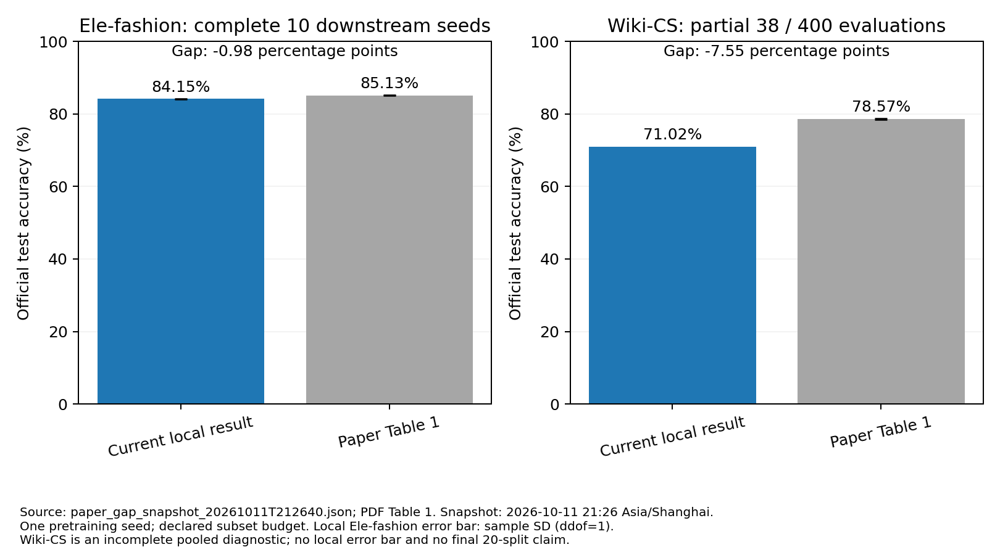

# 已完成工作与论文差距审查

状态时间：2026-10-11 21:26:40（Asia/Shanghai）。运行仍在继续，本文件是冻结快照，不会自动刷新。

## 结论

目前只有 Ele-fashion 完成了全部十个下游随机初始化，测试均值 84.1524%，样本标准差 0.0657 个百分点；论文 Table 1 为 85.13±0.03%。均值低 0.9776 个百分点，数值接近，但方法预算与未公开实现细节仍不完全相同。

Wiki-CS 当前完成 38/400 个 split/初始化组合，仅涉及 split 0 与 split 1。全部已完成记录的混合均值为 71.0171%，比论文整体均值 78.57% 低 7.5529 个百分点。它不是最终二十 split 结果，也不能把混合标准差当作论文同口径的随机种子波动。差距较大，不能从 Ele-fashion 的接近推断所有数据集都接近。

本次逐 run 读取 test_predictions.npz，以 prediction==labels 重新计算 accuracy，并核对保存 summary；没有选择最好的 test run，也没有把验证准确率当测试准确率。

## 成绩与完整性

- Ele-fashion：seed 0–9 全部完成；84.1524±0.0657%，mean±sample SD，ddof=1。对照论文 85.13±0.03%，差 -0.9776 pp。仍共用一个 pretraining seed=42，不是十次独立预训练。
- Wiki-CS split 0：20/20 个初始化完成，71.2323±0.0225%。这只是一个 split，不能作为论文的二十 split 最终结果。
- Wiki-CS split 1：18/20 个初始化完成，70.7780±0.0502%。该 split 本身也未完成。
- Wiki-CS 已完成 38 个组合：混合均值 71.0171%，仅用于观察；二十 split 的最终平均及统计口径尚不可报告。
- 其余八个主任务数据域、few-shot、CLIP 基线和消融：本快照尚无完整正式结果，不填写指标、不外推与论文的差距。

## 已完成的工作

1. 原作者 model.py、fusion_modules.py 和论文原字节保留，原始哈希核验一致。
2. 十个数据域完整图、划分与 CLIP 特征准备；发布者校验与固定版本、本地指纹、特征语义核验持续保留。无发布者校验值的来源只记录本地指纹，不伪称发布者校验。
3. 实际 Torch/DGL CUDA 验证、Windows 运行入口、日志/TensorBoard/CSV/JSONL、RNG与采样游标检查点、安全暂停与原子 I/O 重试已实现；79 项测试通过。
4. Products + Goodreads-LP + Cloth 联合预训练完成：完整作者主模型，8 个声明的固定子集轮次，10240 次 optimizer 更新。
5. 该模型完成 Ele-fashion 的十个 frozen linear probes；Wiki-CS 正在评测。

当前账本已完成 49/1471 个作业，其中 1 个预训练、10 个 Ele-fashion 评测、38 个 Wiki-CS 评测。这个计数不能等同于耗时完成率或整篇论文完成率。

## 与论文一致的已披露部分

- 常规联合预训练语料为 Products/Goodreads-LP/Amazon-Cloth；不是用 Ele-fashion 单域预训练替代迁移实验。
- 2 层 GAT、1024 维、dropout=.3、每视图 6 专家（总 18）、top-2、损失权重 TV/TF/VF=.5/.1/.5、lr=1e-4、PPR top-128。
- 文本-only 域复用 CLIP 文本特征作为视觉占位。
- 冻结编码器、官方下游划分、linear probe lr=.05、最多 2000 轮、验证选择、测试不用于选模。
- 十次下游初始化；Wiki-CS 当前按 20 split×20 初始化的显式网格执行。

## 仍存在的协议与覆盖差异

- 作者只提供两份模型代码。Products 子集大小、选择、seed batch、PPR alpha/epsilon/方向、混合比例及完整训练参数均不充分公开。
- 本地固定池 Products/Books-LP/Cloth=16384/16384/8192，batch=32。Products 子集有论文依据；Book/Cloth 限额是额外容量适配，不能伪称作者参数。8 个子集轮次不等于已确认作者原始每轮预算。
- PPR alpha=.15、epsilon=1e-4、round-robin 混合、Adam、梯度裁剪1.0属于明确重建/工程设置；精确 CLIP 文本拼接/截断与作者生成脚本仍无法确认。
- 下游 optimizer/patience、Wiki-CS 的官方 stopping-mask/loss 选模方式属于明示重建选择；作者原文没有足够细节确认这些逐项等价。
- 当前只用一个联合预训练 seed，多次下游初始化不能替代多次独立端到端训练。
- Windows Python3.9.13/Torch2.1.2 cu118/DGL1.1.2，与论文 Linux/Torch2.8 CUDA12.8/DGL1.1.3/5090服务器不同。
- 第二套 few-shot 预训练、其他主域、CLIP 对照、九个消融尚未完成；其他竞争方法重训、噪声/超参数扫描和全篇分析尚未纳入完整实现。不能宣称整篇论文已经复现。

## Wiki-CS 图计数核查

论文 Table 5 为11701节点、216123条边。当前保留官方原始链接列表：297110条存储边、291039个唯一有向对、601条自环；折成唯一无向节点对后恰为216123，与论文计数一致。

因此不能把297110与216123的表面差异直接当成下载错误。当前推理保留原始方向和重复边，作者是否使用无向化或去重仍需证据确认；它是需要优先审查的协议项，但当前证据不能证明它造成了7.55 pp差距。也不能仅因测试分数较低就修改拓扑、重选种子或覆盖这轮结果。

## 下一步审查优先级

继续保存正在进行的完整官方网格结果。优先按论文/官方加载器证据核对 Wiki-CS 的方向与边处理、CLIP 文本生成方式、stopping/validation 选模协议，再结合其他域判断是局部协议问题还是跨域表征差距。任何新配置需新建实验、以验证集评估并保留当前结果，不能依据测试集挑最有利配置。

## 可复核来源

- 论文：CAME 4545 ICML 2026.pdf，第7页 Table1、第14–16页实现/子集协议、第15页 Table5。
- 本次原始逐seed结果与统计：artifacts/audit/paper_gap_snapshot_20261011T212640.json。
- 训练证据：runs/20261011T105355Z_suite_pretra_0c927d_s42_9521d7/summary.json。
- 数据与环境：各 prepared manifest、artifacts/audit/preflight_reproduction.json。
- 本文件只作审查，不改变运行中的代码、数据、参数或账本。
